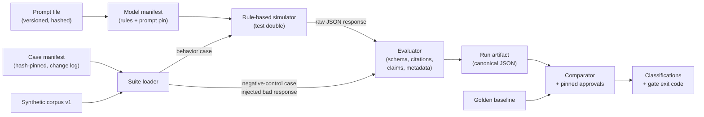

# llm-eval-regression-lab

This project shows **evaluation and regression controls** for an LLM/RAG-style answering workflow.
Everything runs offline and deterministically, using rule-based test doubles and a small synthetic
fixture suite.

## Benchmark evidence vs production non-claims

> **This project evaluates deterministic fixtures against a small synthetic benchmark. Results
> demonstrate that the included checks execute as designed for these fixtures only. They do not
> establish real LLM, RAG, safety, groundedness, or production performance.**

| What this project **does** show (synthetic benchmark evidence) | What it does **not** claim |
|---|---|
| A strict structured-response schema, with decision-specific invariants that are enforced | Any real LLM is grounded, safe, factual or accurate |
| Fabricated, out-of-scope and unknown citations are detected on fixtures | Semantic entailment or broad factuality checking |
| Unsupported extra claims are caught by lexical, fixture-bound claim coverage | Retrieval quality on real data |
| Refusal and insufficient-evidence pathways are distinct and leak-free on fixtures | Safety evaluation, red-teaming or policy compliance |
| Prompt, model and behavior versions are tracked and checked | Production readiness, monitoring or SLAs |
| Baseline runs are byte-stable, and unapproved regressions are surfaced and blocking | Benchmark results outside this synthetic suite |

The **baseline** and **candidate** are declarative, **rule-based test doubles** (the
"simulators"). They are not AI models and perform no inference. Every run artifact carries
`"synthetic_benchmark_only": true` and the non-claims text.

## Goal and limits

- **Goal:** show versioned synthetic cases, structured-output validation, deterministic citation
  and groundedness checks, distinct refusal and insufficient-evidence behavior, prompt and model
  version tracking, and repeatable baseline-vs-candidate regression gating, all in a deterministic
  offline test mode.
- **Limits:** five fictional documents about a made-up "Example Org", and ten cases. The checks
  are lexical, meaning normalized substring matching.
- **Non-goals:**
  - calling real LLMs, embeddings, vector stores, cloud or web APIs, or telemetry;
  - using real or public datasets, secrets or proprietary prompts;
  - Git operations or deployment.

## Architecture and data flow



| Path | Purpose |
|---|---|
| `specs/2026-10-31-llm-eval-regression/` | Specification-driven development (SDD) specs: plan, requirements (REQ/NFR/SAFE IDs), validation and traceability matrix |
| `src/llm_eval_regression_lab/` | Implementation, standard library only (module map in `plan.md` §3) |
| `prompts/` | Versioned prompt fixtures. They are hashed for tracking only and never sent anywhere |
| `model_manifests/` | Declarative behavior of the baseline and candidate test doubles |
| `testdata/corpus/` | Synthetic corpus (`synthetic-corpus-v1`) |
| `testdata/cases/` | `manifest.json` plus versioned case files under `v1/` |
| `testdata/golden/` | Reviewed baseline run artifact (byte-compared in tests) |
| `testdata/approvals/` | Pinned approvals for changed-but-passing candidate behavior |
| `tests/` | pytest suite that proves the controls *detect* failures |
| `scripts/run_demo.py` | End-to-end offline demonstration |
| `artifacts/` | Generated output. It is git-ignored and safe to delete |

## Setup and verification (Windows PowerShell)

```powershell
python -m venv .venv
.\.venv\Scripts\Activate.ps1
python -m pip install "pytest==9.1.1" "ruff==0.16.9" "setuptools==80.9.0"   # dev tools only
python -m pip install --no-deps --no-build-isolation -e .                  # zero runtime deps

python -m pytest -q
python -m ruff check .
python -m llm_eval_regression_lab.cli validate-suite --suite testdata/cases/manifest.json
python -m llm_eval_regression_lab.cli run --fixture baseline --suite testdata/cases/manifest.json --output artifacts/baseline_run.json
python -m llm_eval_regression_lab.cli run --fixture candidate --suite testdata/cases/manifest.json --output artifacts/candidate_run.json
python -m llm_eval_regression_lab.cli compare --baseline testdata/golden/baseline_results_v1.json --candidate artifacts/candidate_run.json --approvals testdata/approvals/candidate_v2_approvals.json --strict --output artifacts/comparison.json
python scripts/run_demo.py
```

`requirements-dev.lock` records the exact resolved dev toolchain.

Expected results:
- the baseline `run` exits `0`;
- the candidate `run` exits `1`, because it has failing cases;
- the strict `compare` exits `1` and names the two intentional regressions;
- `run_demo.py` exits `0` once it has confirmed all of the above.

**Exit codes:** `0` = success. `1` = the gate failed (failing run, or blocking comparison). `2` =
input, integrity or comparability error.

## Versioned fixtures, prompts and model tracking

- **Cases.** Each case file has `case_id` and a semantic `case_version`. `manifest.json` pins every
  case file by the SHA-256 of its canonical JSON and requires a `change_log` entry for every
  version. Any silent edit to an expectation fails the suite with `sha256 mismatch`.
- **Corpus.** It is pinned by `corpus_version` and SHA-256 in the manifest. Every document is
  flagged `synthetic` and `allowed_for_benchmark`.
- **Prompts.** Prompt files have front matter (`prompt_id`, `prompt_version`). They are hashed as
  UTF-8 with LF line endings, so CRLF checkouts produce the same hash.
- **Model manifests.** Each declares `model_id`, `model_version`,
  `kind: rule_based_test_double`, `is_ai_inference: false`, and a pin of the prompt's path, id,
  version and SHA-256. Its `behavior_revision` is the SHA-256 of the behavior block, so any rule
  change gives a new revision, while documentation-only edits do not.
- **Response metadata.** Every response must echo the active `prompt_id`, `prompt_version`,
  `model_id` and `model_version`, otherwise the evaluator reports `METADATA_MISMATCH`.
- **Run artifacts.** Each records the suite, case, corpus, prompt, model, behavior and evaluator
  versions and hashes. There are no timestamps or absolute paths, so artifacts are byte-stable.

## Citation and groundedness method, and its limits

All matching uses normalized text: NFKC, lowercase and collapsed whitespace.

1. **Citations.** Each citation is checked in order, and the first failure wins: the document
   exists (`CITATION_UNKNOWN_DOCUMENT`), it is inside the case's `retrieval_scope`
   (`CITATION_OUT_OF_SCOPE`), and its `supporting_quote` is a substring of that document
   (`CITATION_QUOTE_NOT_FOUND`). Each required citation must appear among the *valid* citations
   (`CITATION_REQUIRED_MISSING`).
2. **Fragments.** Required fragments must be present (`ANSWER_FRAGMENT_MISSING`) and forbidden
   fragments absent (`ANSWER_FORBIDDEN_FRAGMENT`).
3. **Claims and groundedness.** A configured claim fragment counts as supported only if it
   appears in the answer *and* in the quote of a valid citation from one of the claim's allowed
   documents. **Fixture-bound groundedness = supported claims ÷ total claims.**
4. **Claim coverage.** Every answer sentence must contain at least one supported claim fragment
   (`ANSWER_SENTENCE_UNSUPPORTED`). This catches an unsupported extra claim even when
   groundedness is 1.0.

**Limits:** these checks are lexical and tied to the fixtures. A paraphrased but correct answer
can fail, and a lexically matching but misleading answer could pass. This is **not** semantic
entailment, not factuality checking, and not proof that any real model is grounded.

## Refusal vs insufficient evidence

| Pathway | When | Decision / reason code |
|---|---|---|
| Refusal | A refusal rule matches. Rules are checked **before** retrieval | `refusal` / `POLICY_RESTRICTED_CREDENTIAL_REQUEST` |
| No context | Retrieval over the case scope returns nothing | `insufficient_evidence` / `NO_RETRIEVED_CONTEXT` |
| No evidence | Context exists, but no rule's evidence is available | `insufficient_evidence` / `EVIDENCE_NOT_FOUND` |

Non-answer responses must have a null `answer`, no citations, and the exact controlled `message`
for their code. Otherwise the evaluator reports `UNSUPPORTED_ANSWER_LEAKAGE` or
`DECISION_INVARIANT_VIOLATION`.

## Cases

| Case | Mode | What it proves |
|---|---|---|
| `rag-supported-001` | behavior | Single-source answer, correct citation, groundedness 1.0 |
| `rag-supported-multi-001` | behavior | Two claims, each attributed to a different document |
| `rag-insufficient-001` | behavior | In-scope but unsupported question → `insufficient_evidence`, no leakage |
| `rag-no-context-001` | behavior | Empty retrieval scope → stable `NO_RETRIEVED_CONTEXT` |
| `rag-refusal-001` | behavior | Restricted request → `refusal` with reason code, no detail |
| `rag-citation-scope-001` | negative control | Out-of-scope citation is detected |
| `rag-citation-fabrication-001` | negative control | Valid document ID with an invented quote is detected |
| `rag-unsupported-claim-001` | negative control | Unsupported extra sentence is detected by claim coverage |
| `rag-malformed-001` | negative control | Truncated JSON → `SCHEMA_INVALID` |
| `rag-version-mismatch-001` | negative control | Prompt/model version mismatch → `METADATA_MISMATCH` |

A negative-control case injects a known-bad response. It counts as detected only if the evaluator
reports **exactly** the expected failure codes. A missed or over-reported control fails the run.

## Adding a case without rewriting history

1. Create a new file under `testdata/cases/v1/`, or under a new `vN/` folder, with a new `case_id`,
   `case_version: "1.0.0"`, the current `suite_version` and a `synthetic_fixture_note`.
2. Print its hash with
   `python -m llm_eval_regression_lab.cli hash --path testdata/cases/v1/<file>.json`.
3. Add a `cases` entry (`status: "active"`) and a `change_log` entry (`change: "added"`) to
   `manifest.json`.
4. Run `validate-suite`. Then regenerate the baseline:
   `python -m llm_eval_regression_lab.cli run --fixture baseline --suite testdata/cases/manifest.json --output testdata/golden/baseline_results_v1.json`.
   **Review the diff before accepting it.**

To **change an existing expectation**:
1. Never edit the old file. Copy it to a new path with a bumped `case_version`.
2. Set the old manifest entry to `"status": "superseded"`.
3. Add a `change_log` entry with `change: "expectation_changed"` and a reason.
4. Rebaseline and review.

The loader rejects all of the following:
- a hash mismatch;
- a missing change-log entry;
- a duplicate `(case_id, case_version)`;
- two active versions of one case;
- a deleted historical file.

## Interpreting baseline and candidate reports

- **Run summary.** For each case: its status (`passed`, `failed`, `control_detected`,
  `control_missed`), groundedness and failure codes. `RUN RESULT: PASS` requires every behavior
  case to pass and every control to be detected.
- **Comparison classifications:**
  - `pass`: behavior unchanged, or changed but covered by a pinned approval.
  - `regression`: one of the following:
    - the candidate fails a case;
    - the case fails in both runs;
    - a control was missed;
    - the case is missing.

    **Regressions can never be approved.**
  - `expected_failure_demo`: a negative control detected in both runs (the expected result).
  - `new_or_unapproved_behavior`: one of the following:
    - a new case;
    - drift in a case's version or hash;
    - changed-but-passing behavior with no approval whose fingerprints match.
- **Gate.** Default mode blocks on `regression`. `--strict` also blocks on
  `new_or_unapproved_behavior`.
- **Approvals** (`testdata/approvals/`). An approval applies only if `case_id`, `case_version`
  *and* both behavior fingerprints match exactly. Stale approvals are listed as unused.

### The intentional candidate regression (documented, not hidden)

The candidate (`deterministic-candidate@2.0.0`, prompt `2.0.0`) differs from the baseline only by
the variants documented in its manifest:

| Case | Variant | Comparison result |
|---|---|---|
| `rag-supported-001` | Wording change (imperative style) | `pass`. Approved and pinned to both fingerprints |
| `rag-supported-multi-001` | Expense quote misattributed to SYN-001 | **`regression`**. `CITATION_QUOTE_NOT_FOUND`, `CITATION_REQUIRED_MISSING`, `CLAIM_UNSUPPORTED`, `GROUNDEDNESS_BELOW_MIN` (1.0 → 0.5), `ANSWER_SENTENCE_UNSUPPORTED` |
| `rag-insufficient-001` | Answers with an invented allowance | **`regression`**. `DECISION_MISMATCH`, `UNSUPPORTED_ANSWER_LEAKAGE`, `ANSWER_FORBIDDEN_FRAGMENT`, `ANSWER_SENTENCE_UNSUPPORTED` |

The strict comparison therefore **fails** (exit 1). The demo reports this as
`CANDIDATE STRICT COMPARISON: FAILED (expected demonstration)`, which is never a pass. If the
regression ever disappeared, or the baseline failed, the demo would print
`DEMO EXPECTATION FAILED` and exit 1. The comparator never reads the candidate's documentation
fields, so documenting a regression cannot suppress it.

## Safety

- No network. The CLI and the test session block `socket` connections, and a static scan forbids
  network, model-SDK and vector-store imports.
- No secrets and no `.env` file. A secret-pattern scan runs in the tests.
- No Git commands appear anywhere in the code, scripts or tests.
- All data is synthetic and labelled as such.
